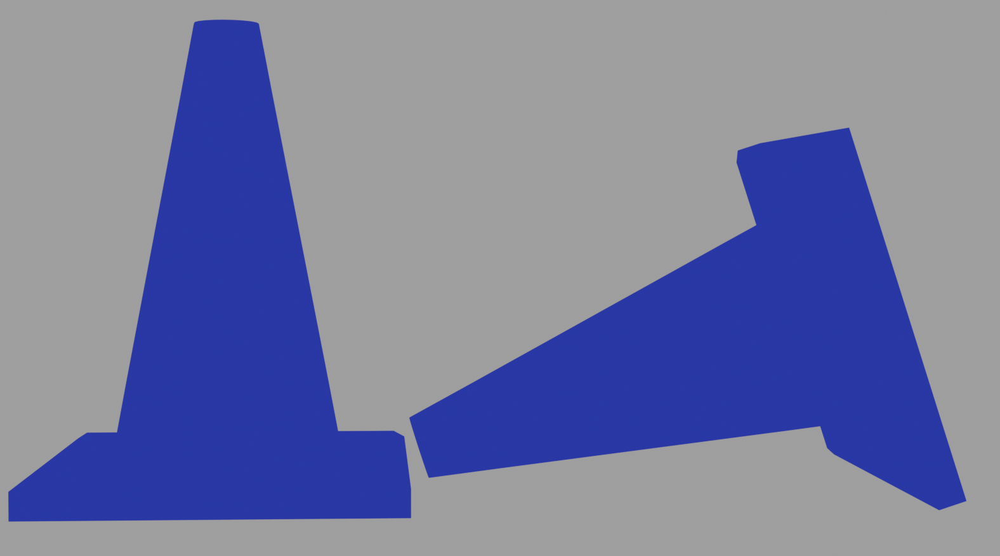
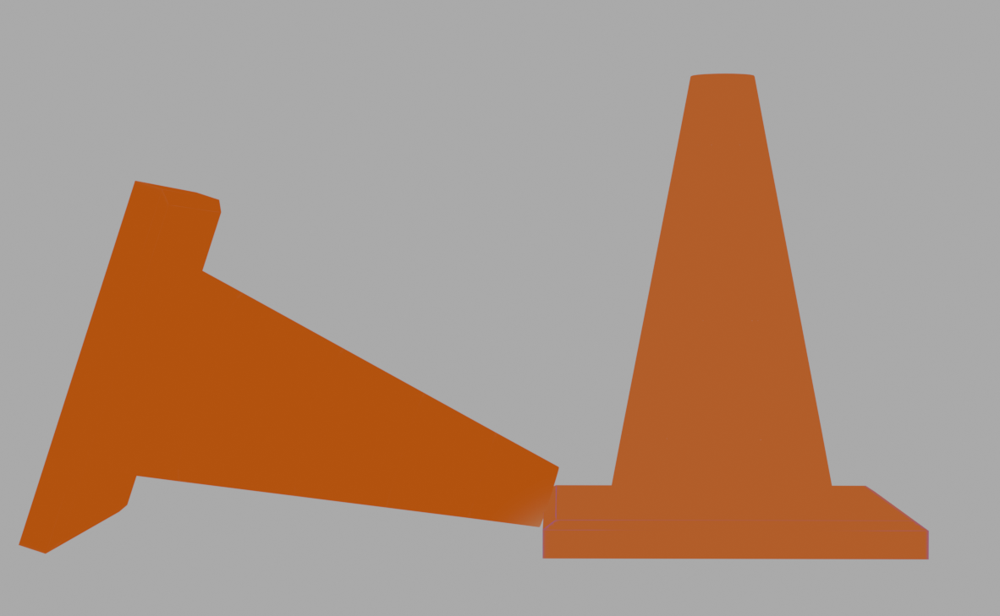
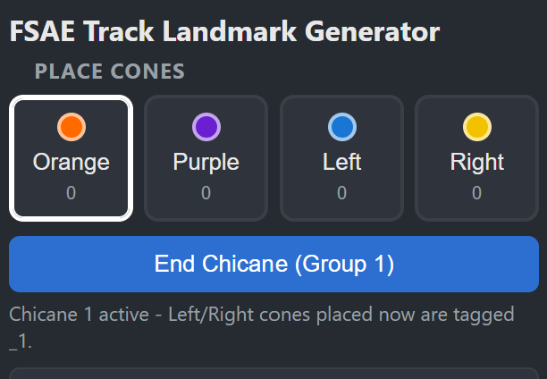
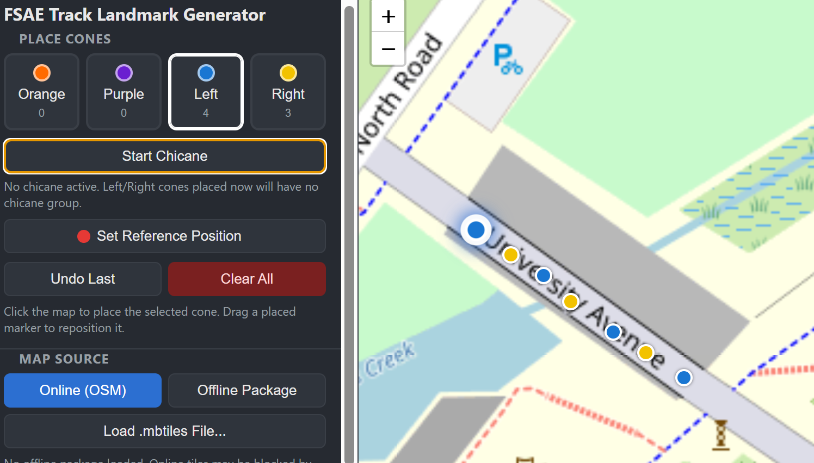

**What is it?**
The **[FSAE_track_generator](https://github.com/cakemun/FSAE_track_generator)** is a web application which allows for the creation of FSAE track layouts without touching grass. The tool allows for the generation of track layouts without the requirement of using the  **[FSAE-Track-Mapper](https://github.com/cakemun/FSAE-Track-Mapper)** to gather real-world GPS points. You can place track features (cones, chicanes) through an interactive map and import existing .kml files and export created track layouts. Exported .kml files can be used by the **[FSAE_track_virtualiser](https://github.com/cakemun/FSAE_track_virtualiser)** (made public shortly)

**Who's it for**
This tool is intended for team members looking to create virtual track layouts for drivers to practice. Additionally the tool allows for the analysis of track layouts for competition use and planning.

## Key Features

All content for app is held within the single .html file.

Within the Track generator there are five key track features which you can place.

**Reference Position**
The reference position is a global anchor point for the GPS points, such that they can be converted into a coordinate system blender can ingest. The reference point should be a prominent feature of the track such that later when we import the layout into blender the position of cones can be aligned between virtual and real-world placement.

**Orange Cones**
The orange cone feature refers to the placement of singular orange cone. Within the FSAE handbook, an orange cone is an indicator of the left-hand side of the track i.e. you must keep the cone to the left of the vehicle.

**Purple Cone** 
The purple cone feature refers to the placement of singular purple cone. Within the FSAE handbook, a purple cone is an indicator of the right-hand side of the track i.e. you must keep the cone to the right of the vehicle.

**Left Cone**
The left-cone feature refers to the placement of two purple cones one upright, and a direction indicator cone (a cone lying down. pointing the correct direction of travel). The cone structure is used within FSAE-A track layouts and is usually used to indicate the direction of travel line chicane, in this case passing to the left of the cone.

**Right Cone**
The right-cone feature refers to the placement of two orange cones one upright, and a direction indicator cone (a cone lying down. pointing the correct direction of travel). The cone structure is used within FSAE-A track layouts and is usually used to indicate the direction of travel line chicane, in this case passing to the right of the cone.

## Making your first track

To create your first track you first set your reference point (which will act as the reference anchor for the rest of the track if you virtualise it), after which you can place a set of cone features. the sequential placement of cones does not matter, unless you are generating a chicane.
## Making a Chicane

As Left and Right cone features are the only features which need a specified orientation, they are the only features which can form part of a chicane feature.

The Chicane feature allows the user to specify the direction of travel such that features can be aligned properly. **The direction of travel is indicated by the  chicane number order, with the lowest chicane element being the start of the chicane, and the highest being the final element of the chicane**

To make a chicane complete the following:
- Press Start Chicane - on press the chicane button will specify  the chicane group.

- Now select the chain of cones you wish to generate - the order in which you place the cones will dictate the direction of travel, with the first cone placed in the chicane group specifying the start of the chicane.
- After you have placed all the cones in the chicane group - press the "End Chicane" button.

- At any point you can resume a chicane group by selecting the group tag in the placemarks list.
## Offline Maps

It is strongly encouraged to use offline map tiles when using this tool. This can be done through importing a .mbtiles package and pressing the Offline Package button.
## Map Tools

In the map tools there is a basic ruler and a grid overlay system to assist scaling maps
## Placemarker list

The placemarker list displays a list of all active track features and allows review and modification of cone features.
## Import and Export

There is the ability to both import existing track layouts for further modification or review and the export of new tracks

Happy Racing!